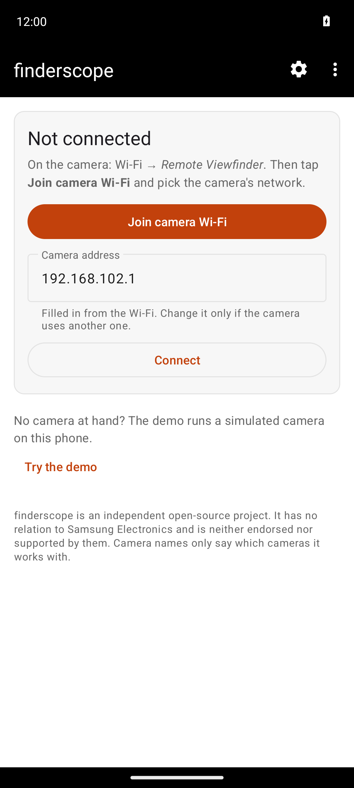
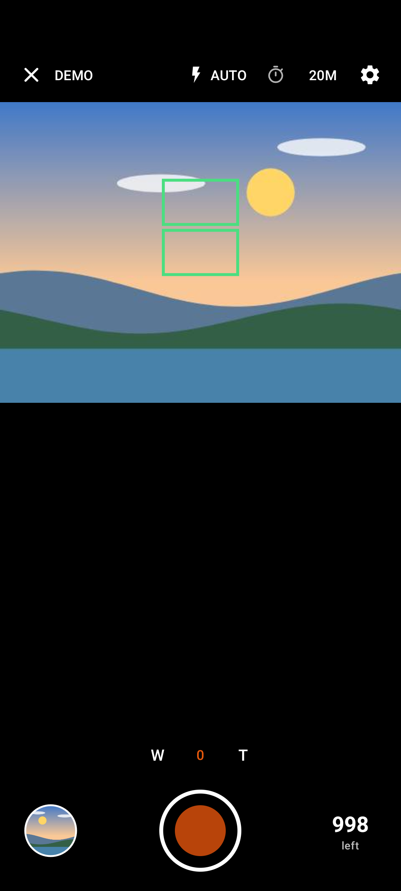
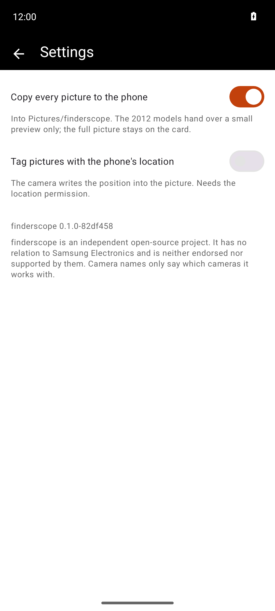
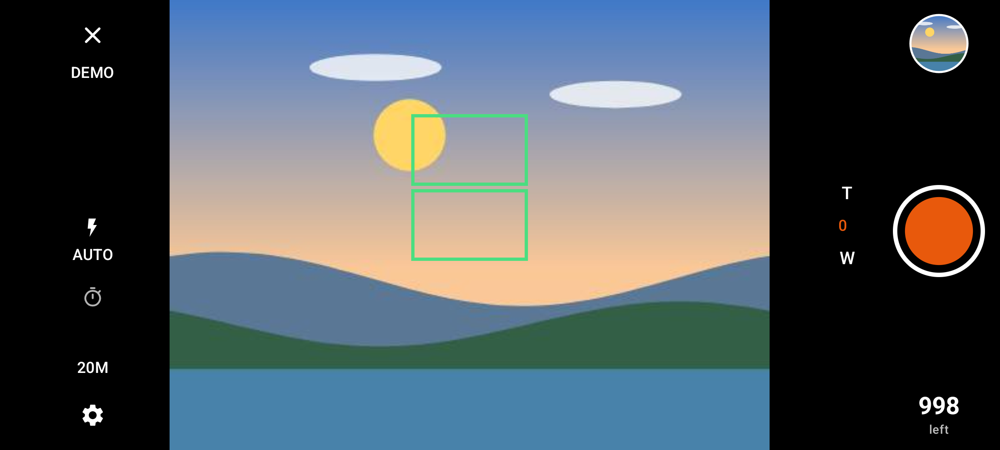

  
  
  
  
  

# finderscope

See what your Samsung Wi-Fi camera sees, on your Android phone, and take the picture from there.
The cameras of 2012 to 2014 have a *Remote Viewfinder* mode for exactly this, but the apps that
used it are gone from the stores and no longer run on current phones. finderscope is a new,
open-source app for that mode: live view, shutter, self-timer, flash, photo size and zoom, with
the camera's own focus frames.

> finderscope is an independent open-source project. It has no relation to Samsung Electronics
> and is neither endorsed nor supported by them. "Samsung" and the camera model names only say
> which cameras it works with.

**Cameras:** models with *Remote Viewfinder* in their Wi-Fi menu: NX1000, NX1100, NX20, NX210,
NX2000, NX300, NX300M, NX3000, NX mini, WB150F, WB250F, WB800F, WB850F, ST200F, DV300F, EX2F and
similar. Built with the NX1000 in mind; see the status line below for what has been tried.

## Getting started

1. Install the APK from the [releases page](https://github.com/PhilippMundhenk/finderscope/releases)
   (Android 10 or newer).
   A Play Store release needs 12 testers first: if you own one of these cameras, see
   [issue #9](https://github.com/PhilippMundhenk/finderscope/issues/9).
2. On the camera: Wi-Fi → *Remote Viewfinder*. The camera opens its own Wi-Fi network. Wait until
   it shows its **Cancel** button, then give it 5 more seconds before connecting.
3. In finderscope: **Join camera Wi-Fi** and pick the camera's network in the list Android shows.
   Mobile data stays on for everything else on the phone.
4. The camera asks whether to allow this phone: confirm on the camera. It asks every time Remote Viewfinder starts.
5. Hold the shutter button to focus (the frames that are in focus light up), release to take the
   picture. Slide off the button to cancel. The volume keys work as a shutter too.

Pictures are stored on the camera's card as usual. finderscope also copies each one into
*Pictures/finderscope* on the phone (switch this off in Settings). The 2012 models hand over a
small preview only; the full picture stays on the card.

No camera at hand? **Try the demo** runs a simulated camera on the phone.

Everything the app can do, and tips: [docs/APP.md](docs/APP.md).

## Screenshots

| Start | Live view | Settings |
|---|---|---|
|  |  |  |

Taken against the built-in demo camera; more in [docs/screenshots.md](docs/screenshots.md).

## Better than the original

finderscope was built from what the original apps did on the wire, not from their code
([docs/BEHAVIOR.md](docs/BEHAVIOR.md)). Where they were fragile, it does better:

* joins the camera network without deleting or toggling your Wi-Fi settings;
* never sends the camera two commands at once (the NX1000 hangs on that);
* a stalled or dropped live view comes back on its own instead of ending the session;
* a failed picture is reported and can be retried; the original quit;
* the self-timer's *off* really is off; GPS tags have the right hemisphere;
* pictures are saved byte for byte, with the camera's EXIF data.

## Documentation

* [docs/APP.md](docs/APP.md) — using the app: connecting, shutter, settings, troubleshooting
* [docs/PROTOCOL.md](docs/PROTOCOL.md) — what the camera does on the wire (reverse engineered)
* [docs/BEHAVIOR.md](docs/BEHAVIOR.md) — how the original app behaved, what finderscope does instead, the conformance scenarios
* [docs/DEVELOPMENT.md](docs/DEVELOPMENT.md) — building, tests and coverage, CI, releases
* [docs/DESIGN.md](docs/DESIGN.md) — design notes, [docs/BRANDING.md](docs/BRANDING.md) — look and feel

Status: complete against a simulated camera (the conformance suite and the UI tests); not yet
tried on a real camera. Reports from real cameras are very welcome:
[GitHub issues](https://github.com/PhilippMundhenk/finderscope/issues).

Related: [Samsung Camera Backup](https://github.com/PhilippMundhenk/SamsungCameraServer) brings
back the cameras' *Auto Backup* to a phone or a home server.
