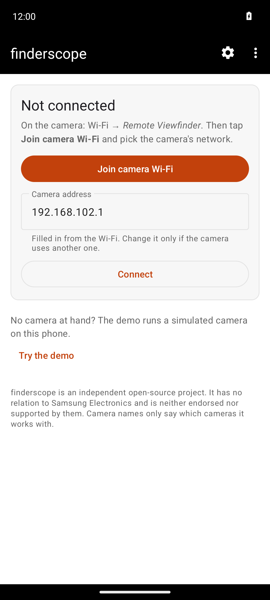
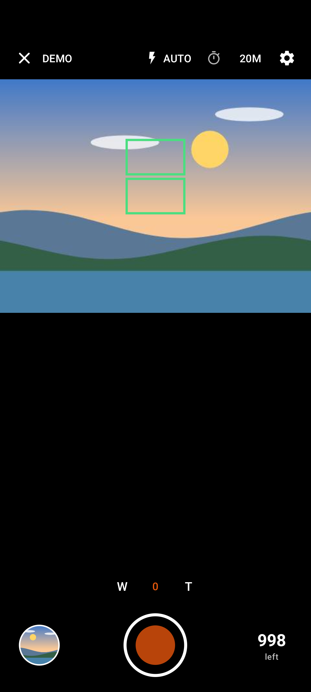
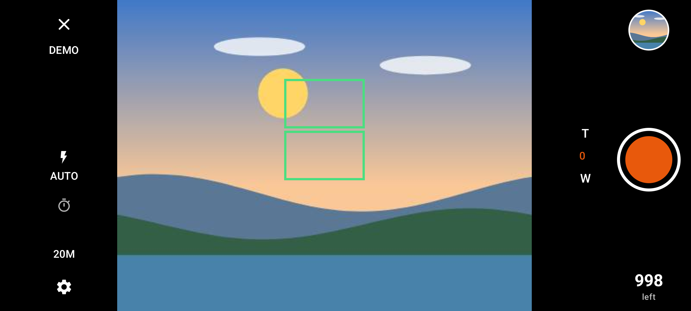

# Screenshots

Taken by the UI tests on the CI emulator (`ScreenshotTest`) against the built-in demo camera:
no real camera, no real photos. They are refreshed on every build of `main` (branch
`screenshots`) and copied here by hand.

## Start screen

How to connect: the camera's Wi-Fi, the camera address, the demo.

## Live view

The camera's picture with the focus frames of a half-pressed shutter, remaining shots, flash,
self-timer, photo size, zoom (W / T), the last picture bottom left.

## Live view in landscape

Wide windows put the settings in a column on the left and the shutter, zoom, last picture and
shots left in a column on the right; the picture stays clear between them. Tall windows (the
upright phone above, a foldable's cover screen, split screen side by side) stack top bar,
picture and controls. Only nearly square windows lay the controls over the picture's edges.

## Settings

Copying pictures to the phone, GPS tag, version.

